# Component Selection

**Name:** Sam Kholmuminov 
**Team:** Team 102 – Project Aurora 
**Subsystem:** Storage Environment (Board D: Temperature & Light) 
**Last updated:** October 13, 2026

## What this page is

My board is the **Storage Environment** board in Project Aurora. It watches the temperature and the light level inside the storage area, cleans up the sensor signals with an op-amp, converts them with the ADC on the PIC18F57Q43 Curiosity Nano, and sends alerts to my teammates over the team's 8-wire ribbon cable.

For every major block in my [block diagram](../01-Block-Diagram/06-block-diagram.md) I looked at at least three real parts, listed the good and bad points of each, and then picked one.

How I chose (the rules I had to follow):

* The course gives each team member a **$60 budget**. The Curiosity Nano and the PCB itself do not count against it.
* Every part must have a **datasheet** (no Amazon parts without specifications).
* Through-hole parts are allowed in EGR 304, so I favored through-hole parts because they are easier to solder and to replace.
* My board needs a **5 V linear regulator**, a **barrel jack** for a 9 V wall adapter, and a **removable fuse**.
* No daughter boards or breakout boards.

## Major components on my board

| Block in my block diagram | Part type | Why it is "major" |
|:--|:--|:--|
| Light sensor | Resistive light sensor + amplifier | Sensor (the main analog sensor of my subsystem) |
| Temperature sensor | Resistive temperature sensor + buffer | Sensor |
| Signal conditioning | Op-amp IC | Integrated circuit on the board |
| 5 V regulator | Linear regulator IC | Power |
| External power | 9 V wall adapter | Power source |

---

## 1. Light sensor — **Storage Environment subsystem (light sensing)**

**What it has to do:** tell the difference between "lights off / box closed" and "lights on / box open" inside the storage area, and give the PIC a smooth analog voltage it can read with its ADC. The light changes slowly (someone opens a door), so speed is not important.

*Table 1: Light sensor options*

| **Solution** | **Pros** | **Cons** |
|:--|:--|:--|
| 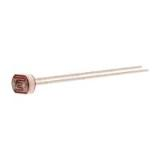 **Option 1.** NSL-19M51 CdS photocell (light-dependent resistor) Advanced Photonix **$1.05 each** [Product page at Digi-Key](https://www.digikey.com/en/products/detail/advanced-photonix/NSL-19M51/5039794) · [Datasheet](https://mm.digikey.com/Volume0/opasdata/d220001/medias/docus/6165/nsl-19m51.pdf) | \* Very large signal: its resistance swings from about 20 MΩ in the dark to 20–100 kΩ at 10 lux, so a simple divider plus a small op-amp gain gives the ADC a wide, easy-to-read voltage range \* Peak sensitivity at 550 nm, which is close to the human eye, so "looks dark to a person" also looks dark to the sensor \* Works from 0 V to 5 V with no bias voltage and no special layout; only two leads \* Through-hole, 5 mm radial package, easy to solder and easy to mount facing the opening of the storage box \* Already used in my Sensor Design schematic, so my KiCad symbol and footprint exist | \* Slow response (tens of milliseconds), so it cannot measure fast flicker (not a problem for this job) \* Resistance drifts a little with temperature |
| 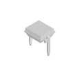 **Option 2.** BPW34 PIN photodiode Vishay **$1.37 each** [Product page at Digi-Key](https://www.digikey.com/en/products/detail/vishay-semiconductor-opto-division/BPW34/1681149) · [Datasheet](https://www.vishay.com/docs/81521/bpw34.pdf) | \* Very fast and very linear: output current is proportional to light \* Wide 130° viewing angle and a large 7.5 mm² active area \* Very low dark current (2 nA), so the "dark" reading is clean \* Through-hole, two leads | \* The signal is a tiny current (microamps indoors), so it needs a transimpedance amplifier with a feedback resistor in the hundreds of kΩ to MΩ range \* Peak sensitivity at 900 nm (infrared), so it responds strongly to things people cannot see (warm bulbs, sunlight leaks) \* Needs a carefully designed op-amp stage to work well \* Most expensive of the three |
| 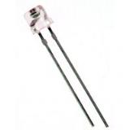 **Option 3.** TEPT5700 ambient-light phototransistor Vishay **$1.13 each** [Product page at Digi-Key](https://www.digikey.com/en/products/detail/vishay-semiconductor-opto-division/TEPT5700/1681193) · [Datasheet](https://www.vishay.com/docs/81321/tept5700.pdf) | \* Built-in gain (it is a transistor), so one resistor turns light into a usable voltage \* Peak at 570 nm, filtered to match the human eye \* Faster than a photocell | \* Only 6 V maximum collector-emitter voltage, so there is almost no safety margin on a 5 V board \* Narrower 100° viewing angle \* Output saturates in bright light, so the useful range is narrow unless the load resistor is tuned carefully |

**Choice:** Option 1, the NSL-19M51 CdS photocell.

**Rationale:** My job is a simple one: "is the storage area lit or dark, and roughly how bright is it." The photocell gives the biggest signal with the simplest circuit. In the dark its resistance is in the megaohms; under room light it drops to tens of kilohms. That means the divider output (photocell from 5 V, 3.3 kΩ to ground) moves by volts, not millivolts, so the op-amp stage only needs a small gain (about 4) to spread the interesting part of the range across the full 0–5 V ADC input. The photodiode (Option 2) is the more precise sensor, but it would force me to build a transimpedance amplifier with a megaohm feedback resistor, and a circuit like that is sensitive to board leakage, noise and layout mistakes, which is a real risk on a first PCB. The phototransistor (Option 3) is a good middle ground, but its 6 V rating leaves no margin on a 5 V rail and its part-to-part spread is large, so I would have to calibrate every board anyway. The photocell is also the part I already breadboarded and drew in my Sensor Design schematic, so choosing it keeps my schematic, symbol library and footprint library unchanged.

---

## 2. Temperature sensor — **Storage Environment subsystem (temperature sensing)**

**What it has to do:** report the temperature inside the storage area (roughly 0–50 °C) well enough to raise a temperature alert when it drifts out of range. One degree of accuracy is plenty.

*Table 2: Temperature sensor options*

| **Solution** | **Pros** | **Cons** |
|:--|:--|:--|
| 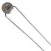 **Option 1.** B57164K0103J000 10 kΩ NTC thermistor TDK (EPCOS) **$0.57 each** [Product page at Digi-Key](https://www.digikey.com/en/products/detail/tdk/B57164K0103J000/739847) · [Datasheet](https://www.tdk-electronics.tdk.com/inf/50/db/ntc/NTC_Leaded_disks_K164.pdf) | \* Biggest signal of the three: with a 10 kΩ divider on 5 V the output moves from about 1.6 V at 10 °C to 3.3 V at 40 °C (roughly 58 mV per °C), so no amplifier is needed, only a buffer and a filter \* Least expensive option \* Two leads, no supply pin, works at any voltage; cannot be damaged by wiring the supply backwards \* Wide range (−55 °C to 125 °C) and rated 450 mW, so self-heating from the 0.25 mA divider current is negligible \* It is the part already in my team block diagram | \* Not linear: the PIC must convert the ADC reading with a small lookup table \* ±5 % resistance tolerance means about ±1–2 °C error unless I calibrate it once \* The fixed divider resistor also adds error, so I should use a 1 % resistor there |
| 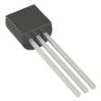 **Option 2.** MCP9700A-E/TO analog temperature sensor IC Microchip **$0.61 each** [Product page at Digi-Key](https://www.digikey.com/en/products/detail/microchip-technology/MCP9700A-E-TO/1212508) · [Datasheet](https://ww1.microchip.com/downloads/aemDocuments/documents/MSLD/ProductDocuments/DataSheets/MCP970X-Family-Data-Sheet-DS20001942.pdf) | \* Linear output, 10 mV per °C with a 500 mV offset, so the math in code is one line \* ±2 °C accuracy with no calibration \* Works from 2.3 V to 5.5 V, draws only 6 µA \* Through-hole TO-92 package | \* Small signal: only 0.6 V to 0.9 V over the 10–40 °C range, which uses less than a tenth of the 5 V ADC range unless I add gain \* Needs a supply pin, a bypass capacitor and correct polarity |
| 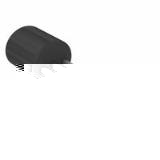 **Option 3.** TMP36GT9Z analog temperature sensor IC Analog Devices **$1.85 each** [Product page at Digi-Key](https://www.digikey.com/en/products/detail/analog-devices-inc/TMP36GT9Z/820404) · [Datasheet](https://www.analog.com/media/en/technical-documentation/data-sheets/TMP35_36_37.pdf) | \* Same simple linear 10 mV per °C output as the MCP9700A \* Well-known part with many application notes and example code \* 2.7 V to 5.5 V supply, low current, has a shutdown pin | \* Three times the price of the thermistor for the same job \* Same small-signal problem as Option 2 (needs gain to use the ADC range) \* ±3 °C accuracy, worse than the MCP9700A \* Needs a supply pin and bypass capacitor |

**Choice:** Option 1, the TDK B57164K0103J000 10 kΩ NTC thermistor.

**Rationale:** The thermistor wins on signal size and on price. With a plain 10 kΩ divider on the 5 V rail, its output changes about 58 mV for every degree, which is almost six times more than the 10 mV per degree from the two IC sensors. That big swing means I do not need any gain for this channel, just one op-amp wired as a unity-gain buffer plus an RC low-pass filter, and the PIC's ADC still gets good resolution (about 0.02 °C per ADC step with the 12-bit ADC). The thermistor's non-linear curve is handled by the B-equation in software (B = 4300 K from the datasheet), which is a few lines of C. Its ±5 % tolerance gives roughly ±1–2 °C of error; that is fine for an alert that triggers when a storage area gets too warm or too cold, and I can calibrate the offset once against a thermometer. Because it is a plain resistor it also cannot be damaged by reversed power and does not need a supply pin or a bypass capacitor.

---

## 3. Signal-conditioning op-amp — **Storage Environment subsystem (amplifier for both sensors and the DAC output buffer)**

**What it has to do:** I need four op-amp sections: (A) a buffer for the photocell divider, (B) the gain stage for the light signal, (C) a buffer for the thermistor divider, and (D) a buffer for the PIC's DAC output that sends the analog temperature level signal to my teammates on ribbon-cable pin 6. All of them run from the single 5 V rail and must swing close to 0 V and 5 V so the PIC's ADC and my teammates' ADCs see the full range.

*Table 3: Op-amp options*

| **Solution** | **Pros** | **Cons** |
|:--|:--|:--|
| 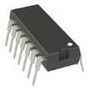 **Option 1.** MCP6004-I/P quad op-amp, 14-pin DIP Microchip **$0.60 each** [Product page at Digi-Key](https://www.digikey.com/en/products/detail/microchip-technology/MCP6004-I-P/523060) · [Datasheet](https://ww1.microchip.com/downloads/en/DeviceDoc/MCP6001-1R-1U-2-4-1-MHz-Low-Power-Op-Amp-DS20001733L.pdf) | \* Four op-amps in one chip: all four stages I need fit in one 14-pin package with one bypass capacitor \* Rail-to-rail input and output: on a 5 V supply the output really goes from about 0 V to 5 V, so no ADC range is wasted \* 1 pA input bias current, so it does not load the high-impedance photocell and thermistor dividers \* Single supply 1.8 V to 6 V, only 100 µA per amplifier \* 1 MHz bandwidth, more than enough for slow sensor signals \* Through-hole DIP, can go in a socket; it is the part already in my Sensor Design schematic | \* 6 V absolute maximum supply, so it can never be run from 9 V by mistake (the 5 V rail must be right) \* 4.5 mV input offset is larger than precision op-amps (small compared to the volts of signal here) \* Only 23 mA output drive per channel (plenty for an ADC input) |
| 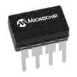 **Option 2.** MCP6002-I/P dual op-amp, 8-pin DIP Microchip **$0.45 each (two needed = $0.90)** [Product page at Digi-Key](https://www.digikey.com/en/products/detail/microchip-technology/MCP6002-I-P/500875) · [Datasheet](https://ww1.microchip.com/downloads/en/DeviceDoc/MCP6001-1R-1U-2-4-1-MHz-Low-Power-Op-Amp-DS20001733L.pdf) | \* Same excellent rail-to-rail, low-bias electrical behavior as the MCP6004 \* Smaller 8-pin package is easier to route around \* Lower cost if only two amplifiers were needed | \* I need four amplifiers, so I would need two chips (more board space, two bypass capacitors, two sockets) and the total cost is higher than one MCP6004 \* Two chips means two places for a soldering mistake |
| 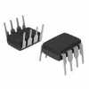 **Option 3.** LM358P dual op-amp, 8-pin DIP Texas Instruments **$0.33 each (two needed = $0.66)** [Product page at Digi-Key](https://www.digikey.com/en/products/detail/texas-instruments/LM358P/277042) · [Datasheet](https://www.ti.com/lit/gpn/lm358) | \* Least expensive \* Wide supply range (3 V to 30 V), so it survives being connected to 9 V by accident \* 40 mA output drive | \* Not rail-to-rail: on a 5 V supply the output tops out around 3.5 V, so the top 30 % of the ADC range is lost \* Input bias current of 20 nA and input offset drift are worse than the MCP parts \* Only two amplifiers per chip, so two chips are needed \* Lower bandwidth (0.7 MHz) and a known crossover-distortion quirk when the output is near 0 V |
| 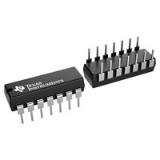 **Option 4.** LM324N quad op-amp, 14-pin DIP Texas Instruments **$0.58 each** [Product page at Digi-Key](https://www.digikey.com/en/products/detail/texas-instruments/LM324N/277627) · [Datasheet](https://www.ti.com/lit/gpn/lm224) | \* Four amplifiers in one chip, same pinout family as the MCP6004 \* Wide supply range (3 V to 32 V) \* Inexpensive | \* Not rail-to-rail: output only reaches about 3.5 V on a 5 V supply, so the ADC range is wasted and the DAC buffer could not pass a full-scale temperature level signal \* 45 nA input bias current loads the sensor dividers more \* 1.5 mA supply current, about 15 times the MCP6004 \* Same crossover-distortion quirk as the LM358 |

**Choice:** Option 1, the MCP6004-I/P quad op-amp.

**Rationale:** One chip does the whole job. I need exactly four amplifier sections, and the MCP6004 gives me four in one 14-pin DIP, so the board has one op-amp, one socket and one bypass capacitor instead of two of everything. The light-sensor gain stage and the DAC buffer both need to swing all the way from 0 V to 5 V, and the classic LM358/LM324 simply cannot do that on 5 V; their outputs stop near 3.5 V, which throws away almost a third of the ADC range and would clip the temperature level signal I send to my teammates. The MCP6004's 1 pA input bias current also matters because both of my sensor dividers are in the 10 kΩ to 100 kΩ range; the LM324's 45 nA bias would pull those nodes slightly and add error that changes with temperature. The 1 MHz bandwidth is far more than my slow sensors need, and 100 µA per amplifier keeps the power budget small. Finally, this is the op-amp already in my Sensor Design schematic and my custom symbol library, so no rework is needed.

---

## 4. 5 V voltage regulator — **Power**

**What it has to do:** take 9 V (up to 12 V) from the barrel jack and make a clean 5 V rail for the Curiosity Nano, the op-amp, the sensors and the LEDs. The course requires a linear regulator, through-hole, that accepts 9–12 V in and gives 5 V out.

How much current does my board need? Worst case, everything on: Curiosity Nano with the PIC running at full speed about 25 mA, three LEDs on at once about 30 mA, op-amp 0.4 mA, sensor dividers under 1 mA. That is about 60 mA; with the 25 % safety margin the course asks for, I plan for **75 mA**. The regulator will then dissipate (9 V − 5 V) × 0.075 A = 0.3 W from the 9 V adapter, or about 0.5 W if a 12 V adapter is used. A TO-220 package in free air rises roughly 50–65 °C per watt (datasheet junction-to-ambient figure), so that is a 15–35 °C rise and no heat sink is needed.

*Table 4: Voltage regulator options*

| **Solution** | **Pros** | **Cons** |
|:--|:--|:--|
| 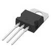 **Option 1.** L7805CV 5 V linear regulator, TO-220 STMicroelectronics **$1.08 each** [Product page at Digi-Key](https://www.digikey.com/en/products/detail/stmicroelectronics/L7805CV/585964) · [Datasheet](https://www.st.com/resource/en/datasheet/l78.pdf) | \* 1.5 A rating, about 20 times my 75 mA need, so it runs cool and I can add features later \* Accepts up to 35 V in, so 9 V or 12 V adapters both work with margin \* Built-in thermal shutdown and short-circuit protection \* Needs only two capacitors \* TO-220 tab can take a heat sink if ever needed | \* Needs at least 7 V in (2 V dropout), so it could not run from a tired 9 V battery \* Wastes the extra voltage as heat (all linear regulators do) |
| 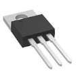 **Option 2.** LM2940CT-5.0 low-dropout 5 V regulator, TO-220 Texas Instruments **$2.00 each** [Product page at Digi-Key](https://www.digikey.com/en/products/detail/texas-instruments/LM2940CT-5-0-NOPB/32575) · [Datasheet](https://www.ti.com/lit/gpn/lm2940-n) | \* Low dropout (about 0.5–1 V), so it keeps regulating even when the input sags to 6 V, which is good for batteries \* 1 A rating, thermal, short-circuit and reverse-polarity protection \* Same TO-220 footprint and pinout as the L7805 | \* Almost twice the price for a benefit (low dropout) that a 9 V wall adapter does not need \* Needs a larger output capacitor (22 µF or more) with a specific ESR range or it can oscillate |
| 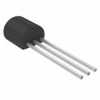 **Option 3.** L78L05ACZ 5 V linear regulator, TO-92 STMicroelectronics **$0.27 each** [Product page at Digi-Key](https://www.digikey.com/en/products/detail/stmicroelectronics/L78L05ACZ/634716) · [Datasheet](https://www.st.com/resource/en/datasheet/l78l.pdf) | \* Least expensive and tiny \* Same protections as the L7805 and up to 30 V input | \* Only 100 mA maximum, so my 75 mA plan leaves almost no margin and any new feature would overload it \* TO-92 package has no tab and heats up fast: 0.3 W gives roughly a 50 °C rise with no way to add a heat sink |

**Choice:** Option 1, the L7805CV.

**Rationale:** The L7805CV is the safe, boring choice, and for a power supply that is exactly what I want. It can deliver 20 times the current my board needs, so it never gets near its limit, and the TO-220 tab lets me bolt on a heat sink if I ever add a motor or a bigger load. Its 2 V dropout is not a problem because the course requires a 9 V (or 12 V) wall adapter, which always leaves at least 2 V of headroom; the low-dropout LM2940 would cost twice as much to solve a problem I do not have, and it is pickier about its output capacitor. The small L78L05 is tempting at 27 cents, but 100 mA is too close to my 75 mA plan, and the TO-92 package would run hot with nothing to cool it. The 7805 circuit is also the one shown in the course examples, so it is easy to review and debug.

---

## 5. External power source — **Power**

**What it has to do:** supply 9–12 V DC into the barrel jack, with enough current for the whole board, for as long as the device needs to run (a storage monitor should run all day, every day).

*Table 5: Power source options*

| **Solution** | **Pros** | **Cons** |
|:--|:--|:--|
| 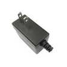 **Option 1.** SWI6-9-N-P5 9 V, 670 mA regulated wall adapter, 2.1 × 5.5 mm center-positive plug Bel Power Solutions (CUI) **$16.13 each (I already have one from the course supply kit, so $0 from my budget)** [Product page at Digi-Key](https://www.digikey.com/en/products/detail/bel-power-solutions/SWI6-9-N-P5/5415074) · [Datasheet](https://belfuse.com/media/datasheets/products/power-supplies/SWI6-N.pdf) | \* Regulated output, so the regulator always sees a steady 9 V (unregulated "wall warts" can read 12–14 V at light load) \* 670 mA is about nine times what my board draws \* Runs forever from the wall; no battery to replace \* 9 V means the L7805 only drops 4 V, so it stays cooler than with 12 V \* UL/CSA listed, standard 2.1 mm barrel plug fits the PJ-102A jack \* I already own it | \* Ties the board to a wall outlet \* Expensive if it had to be bought new \* Needs the barrel jack and a fuse on the board |
|  **Option 2.** SWI6-12-N-P5 12 V, 600 mA regulated wall adapter, same plug Bel Power Solutions (CUI) **$15.21 each** [Product page at Digi-Key](https://www.digikey.com/en/products/detail/bel-power-solutions/SWI6-12-N-P5/5415068) · [Datasheet](https://belfuse.com/media/datasheets/products/power-supplies/SWI6-N.pdf) | \* Also regulated and within the 9–12 V range the course allows \* Extra headroom if a teammate's board or a future actuator needs 12 V \* Slightly less expensive than the 9 V unit | \* The regulator must drop 7 V instead of 4 V, so it dissipates 70 % more heat for the same load (about 0.5 W at 75 mA) \* No benefit for my board, which only needs 5 V \* Would be a new purchase ($15.21 of the $60 budget) |
| 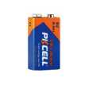 **Option 3.** 6LR61-1B 9 V alkaline battery (about 480 mAh) with a snap connector PKCELL **$2.00 each** [Product page at Digi-Key](https://www.digikey.com/en/products/detail/pkcell/6LR61-1B/11629991) · [Datasheet](https://mm.digikey.com/Volume0/opasdata/d220001/medias/docus/2393/6LR61%209V%20%281%29.pdf) | \* Portable, no outlet needed \* Very inexpensive[^1] to try \* Nominal 9 V matches the regulator input | \* Runs out fast: 480 mAh ÷ 60 mA is only about 8 hours, so it would die during one day of use \* Voltage sags from 9 V to about 7 V as it drains, which is right at the 7 V minimum the L7805 needs, so the 5 V rail would start to droop near end of life \* Ongoing cost and waste; needs a holder or snap \* Does not fit a "monitor that runs all the time" |

**Choice:** Option 1, the 9 V regulated wall adapter (already owned).

**Rationale:** My subsystem is a monitor that should run continuously, so a wall adapter is the only option that makes sense; the 9 V battery would last about 8 hours and its voltage would sag below the regulator's 7 V minimum before it is even empty. Between 9 V and 12 V, 9 V is better for my board because the L7805 has to burn the difference between the input and 5 V as heat, and 4 V of difference makes 0.3 W while 7 V makes 0.5 W at the same 75 mA. Either would work, but cooler is better and there is nothing on my board that needs 12 V. I already have a 9 V adapter from the course supply kit, so this choice costs $0 of my $60 budget, and it plugs straight into the PJ-102A barrel jack with a fuse in series as the schematic assignment requires.

---

## Shopping list

Everything below is from Digi-Key. Parts I already have from the course supply kit or the lab (the 9 V wall adapter, the barrel jack, LEDs, the pushbutton, pin headers, resistors and capacitors) are not listed because they cost $0 of my budget.

*Table 6: Purchase list*

| Item | Part number | Qty | Unit | Line | Status |
|:--|:--|--:|--:|--:|:--|
| Photocell (light sensor), plus 1 spare | [NSL-19M51](https://www.digikey.com/en/products/detail/advanced-photonix/NSL-19M51/5039794) | 2 | $1.05 | $2.10 | buy |
| 10 kΩ NTC thermistor, plus 1 spare | [B57164K0103J000](https://www.digikey.com/en/products/detail/tdk/B57164K0103J000/739847) | 2 | $0.57 | $1.14 | buy |
| Quad op-amp, plus 1 spare | [MCP6004-I/P](https://www.digikey.com/en/products/detail/microchip-technology/MCP6004-I-P/523060) | 2 | $0.60 | $1.20 | buy |
| 5 V regulator, TO-220 | [L7805CV](https://www.digikey.com/en/products/detail/stmicroelectronics/L7805CV/585964) | 1 | $1.08 | $1.08 | buy |
| Fuse clips for a 5 × 20 mm fuse (2 per fuse) | [Keystone 3517](https://www.digikey.com/en/products/detail/keystone-electronics/3517/316010) | 2 | $0.42 | $0.84 | buy |
| Fuse 5 × 20 mm, 500 mA fast-acting, plus 1 spare | [Littelfuse 0217.500MXP](https://www.digikey.com/en/products/detail/littelfuse-inc/0217-500MXP/777537) | 2 | $0.57 | $1.14 | buy |
| 2×4 shrouded box header (team ribbon cable) | [Molex 0702460801](https://www.digikey.com/en/products/detail/molex/0702460801/760165) | 1 | $1.86 | $1.86 | buy |
| 14-pin DIP socket for the op-amp | [3M 4814-3000-CP](https://www.digikey.com/en/products/detail/3m/4814-3000-CP/1133615) | 1 | $1.00 | $1.00 | buy |
| Jumper shunts for the isolation jumpers | [Sullins SPC02SYAN](https://www.digikey.com/en/products/detail/sullins-connector-solutions/SPC02SYAN/76375) | 6 | $0.10 | $0.60 | buy |
| **Parts to buy** | | | | **$10.96** | |
| Estimated Digi-Key shipping (USPS) | | | | about $7.00 | |
| **Estimated total** | | | | **about $17.96** | |
| **Budget** | | | | $60.00 | |
| **Left for mistakes, spares and changes** | | | | **about $42.04** | |

---

## Pin table

How my board connects to the Curiosity Nano and to the team ribbon cable (from my block diagram). The Curiosity Nano has a 56-pin edge connector (two rows of 28, 0.1 in pitch), which is why it needs two female header strips (already on hand).

*Table 7: Pin assignments*

| PIC18F57Q43 pin | Function | Direction | Connected to |
|:--|:--|:--|:--|
| RA0 | ADC input, temperature | in | Thermistor divider through buffer U1C |
| RA1 | ADC input, light | in | Photocell divider through buffer U1A and gain stage U1B |
| RA2 | DAC1 output, TEMP_LEVEL | out | Buffer U1D, then ribbon cable J1 pin 6 (analog) |
| RC5 | Digital output | out | Red warning LED through 330 Ω |
| RD1 | Digital output, TEMP_ALERT | out | Ribbon cable J1 pin 2 |
| RD2 | Digital output, LIGHT_ALERT | out | Ribbon cable J1 pin 3 |
| RD4 | Digital output, HEARTBEAT_D | out | Ribbon cable J1 pin 5 |
| Spare GPIO (one each) | Debug LED, debug pushbutton | out / in | Debug LED through 330 Ω; pushbutton with 10 kΩ pull-up |
| UART TX / RX | Team upstream / downstream UART | out / in | To be assigned on the team block diagram, brought to spare header pins for now |
| VTG (5 V) and GND | Power to the Nano | in | 5 V rail from the L7805; VOFF tied low so the Nano's own regulator is off |

*Table 8: Team ribbon cable J1 (2×4 IDC, course standard)*

| J1 pin | Course standard | My use |
|:--|:--|:--|
| 1 | Digital I/O | spare (team can assign) |
| 2 | Digital I/O | TEMP_ALERT out |
| 3 | Digital I/O | LIGHT_ALERT out |
| 4 | Digital I/O | spare (team can assign) |
| 5 | Digital I/O | HEARTBEAT_D out |
| 6 | Analog I/O | TEMP_LEVEL out (0–5 V, buffered) |
| 7 | Analog I/O | spare |
| 8 | Ground | GND |

---

## Power budget

The full power budget (course Excel template) is on the [Power Budget](../05-Power-Budget/Power-Budget.md) page. Short version: one 5 V rail, about 60 mA worst case, 75 mA with the 25 % margin, supplied by the L7805CV from the 9 V wall adapter, which can source 670 mA.

## Sources I used

* [Individual – Component Selection assignment](https://embedded-systems-design.bitbucket.io/304/individual-assignments/component-selection/) and the [EGR 304 project description](https://embedded-systems-design.bitbucket.io/304/course-info/project-description/) (budget, required microcontroller, 5 V linear regulator, ribbon-cable pinout)
* [Course sequence requirements](https://embedded-systems-design.bitbucket.io/3x4/course-sequence-requirements/) (what counts as an acceptable analog sensor, $60 budget, through-hole allowed)
* [Sources for electrical components](https://embedded-systems-design.github.io/sources-for-electrical-and-electromechanical-components/), [Power Supplies 101](https://embedded-systems-design.github.io/power-supplies-101/) and [Optimizing resistive sensor circuits](https://embedded-systems-design.github.io/resistive-sensor-optimization/) on the Embedded Systems Design blog
* Part datasheets linked in each table above (Digi-Key prices as of October 13, 2026)
* My [Sensor Design schematic](../04-Schematic/schematic.md) and [block diagram](../01-Block-Diagram/06-block-diagram.md)

[^1]: The course asks us to avoid the word "cheap" (it suggests poor quality); "inexpensive" means affordable.
