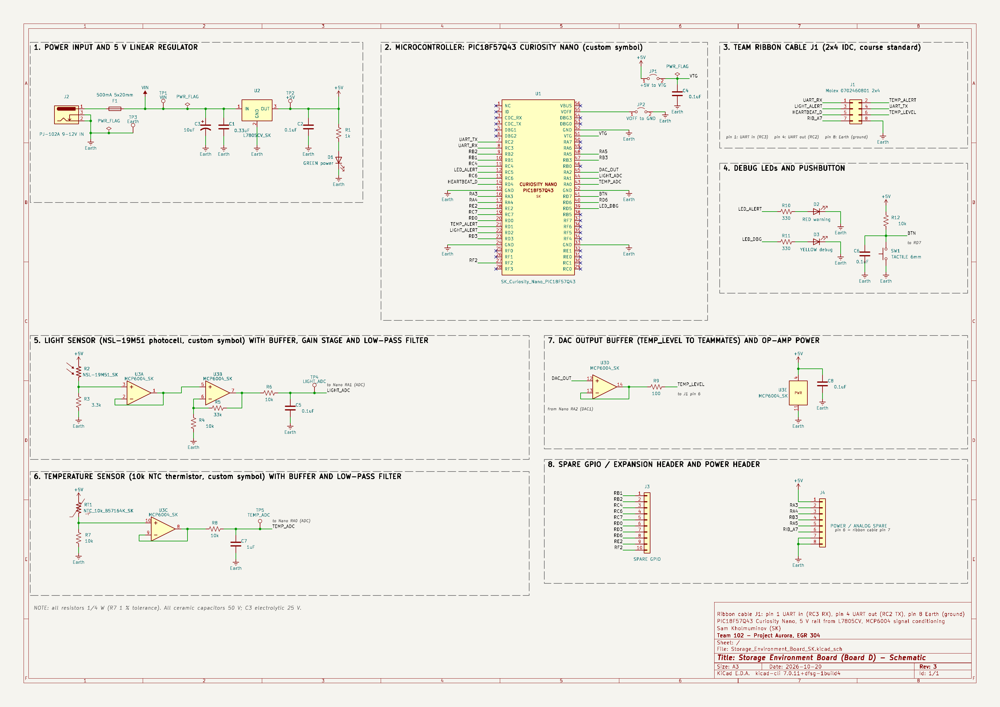

# Schematics

**Name:** Sam Kholmuminov 
**Team:** Team 102 – Project Aurora 
**Subsystem:** Storage Environment (Board D: Temperature & Light) 
**ECAD tool:** KiCad 10 
**Schematic revision:** 3 
**Last updated:** October 20, 2026

## What this page is

This page has the full schematic of my **Storage Environment board**. The board sits inside the storage area of Project Aurora, measures the temperature and the light level, and tells my teammates over the team ribbon cable when something is out of range. The schematic is one A3 sheet drawn in KiCad, split into eight numbered boxes so it is easy to read.

Everything on this page comes from my earlier assignments: the parts are the ones I picked in [Component Selection](../02-Component-Selection/Component-Selection.md), the regulator circuit comes from my Power Supply Design assignment, and the photocell amplifier comes from my Sensor Design assignment (with one fix that I explain below).

## Downloads

| File | What it is |
|:--|:--|
| [Storage_Environment_Board_SK_schematic.pdf](files/Storage_Environment_Board_SK_schematic.pdf) | High-resolution PDF of the schematic, plotted from KiCad (vector, zoom in as far as you like) |
| [Storage_Environment_Board_SK_KiCad.zip](files/Storage_Environment_Board_SK_KiCad.zip) | The whole KiCad project: `.kicad_pro`, `.kicad_sch`, my custom symbol library `EGR304_Sam.kicad_sym`, my custom footprint library `EGR304_SK.pretty`, and the library tables |
| [Storage_Environment_Board_SK_schematic.png](images/Storage_Environment_Board_SK_schematic.png) | The same schematic as a PNG image (shown below) |

The zip was made from the project folder with the custom libraries saved as **project libraries** (`${KIPRJMOD}/EGR304_Sam.kicad_sym`), so the project opens on any computer without missing symbols.

## The full schematic

**Figure 1:** The complete schematic (A3 sheet, revision 3). Click the image to open it full size, or use the PDF above.

## How the board works in one paragraph

A 9 V wall adapter plugs into the barrel jack J2. The current goes through a removable 500 mA fuse and into the L7805 linear regulator, which makes the 5 V rail for everything on the board. The 5 V rail powers the PIC18F57Q43 Curiosity Nano through its VTG pin, the MCP6004 quad op-amp, and the two sensor dividers. The photocell divider goes through a buffer, a gain-of-4.3 stage and a low-pass filter into ADC pin RA1. The thermistor divider goes through a buffer and a low-pass filter into ADC pin RA0. The PIC compares the readings with limits in software and drives three ribbon-cable lines (TEMP_ALERT, LIGHT_ALERT, HEARTBEAT_D), one analog line (TEMP_LEVEL, from the PIC's DAC through a buffer), and the team UART. A red LED shows a warning, a yellow LED is for debugging, and a green LED shows that the 5 V rail is up. All grounds use the **Earth** symbol, the same one I used in my Sensor Design and Power Supply Design schematics.

## Section by section

### 1. Power input and 5 V linear regulator

* **J2** is a PJ-102A barrel jack for the 9 V (up to 12 V) wall adapter, 2.1 mm center positive. Pins 2 and 3 (the sleeve and the insertion switch) both go to Earth, so the ground contact is solid.
* **F1** is a 500 mA fast-acting 5 × 20 mm fuse in two Keystone 3517 clips, so it can be pulled out and replaced. The board only needs about 75 mA (see below), so the fuse never blows in normal use, but it is far below what the 670 mA adapter can push into a short circuit.
* **U2** is the L7805CV in a TO-220 package. C1 (0.33 µF) and C2 (0.1 µF) are the two capacitors the L78xx datasheet asks for. C3 (10 µF, 25 V) adds some bulk storage on the input so the rail does not dip when the LEDs switch or the adapter cable is long.
* **Current and heat:** the worst case load is about 60 mA (Curiosity Nano about 25 mA, three LEDs about 27 mA, op-amp 0.4 mA, sensor dividers under 1 mA). With the 25 % margin the course asks for I plan for **75 mA**. The regulator then burns (9 V − 5 V) × 0.075 A = **0.3 W** (0.5 W with a 12 V adapter). A bare TO-220 in free air rises roughly 50 °C per watt, so that is a 15–25 °C rise and no heat sink is needed.
* **Capacitor voltage margin:** the input side sees at most 12 V, so C3 is rated 25 V (more than double). All the 0.1 µF / 0.33 µF / 1 µF ceramics are 50 V parts on a 5 V rail.
* **D1** (green, 1 kΩ, about 3 mA) shows that the 5 V rail is alive. **TP1, TP2, TP3** are test points for VIN, +5V and Earth, so a meter or scope probe has somewhere to clip.
* The two **PWR_FLAG** symbols tell KiCad's electrical rules check that VIN and Earth really are power nets (they come in through a connector, not from a regulator output).

### 2. Microcontroller: PIC18F57Q43 Curiosity Nano

* I use the **Curiosity Nano development board**, not the bare chip, as the course requires. The symbol `SK_Curiosity_Nano` is my own (initials SK in the name and inside the symbol), drawn with all 56 edge-connector pins in the order of the pinout in the hardware user guide. Pins the board does not use carry an X (no-connect) so the rules check does not complain.
* **Power:** the board feeds 5 V into the Nano's **VTG** pin through **JP1**, and **JP2** ties **VOFF** to Earth. The hardware user guide (section 3.3.2) says that when VOFF is shorted to GND the debugger turns the Nano's own regulator off and an external 1.8–5.5 V can be put on VTG. **C4** (0.1 µF) is the bypass capacitor right at VTG, which is the only power pin on the Nano that my board drives. VBUS (USB 5 V) is left unconnected on purpose; the two jumpers are the "protection between USB and the other input source" from the checklist: with JP1 and JP2 removed the Nano runs on USB alone and my 5 V rail is disconnected from it.
* **UART:** the team's upstream UART comes in on ribbon pin 1 and goes to **RC3 (UART1 RX)**; my **RC2 (UART1 TX)** goes out on ribbon pin 4. RC2/RC3 are the UART pins of the Curiosity Nano standard pinout, so no PPS surprises.
* **Analog pins:** RA0 = TEMP_ADC, RA1 = LIGHT_ADC (ADC inputs), RA2 = DAC_OUT (DAC1 output).
* **Digital pins:** RD1 TEMP_ALERT, RD2 LIGHT_ALERT, RD4 HEARTBEAT_D (to the ribbon cable), RC5 red LED, RD5 yellow LED, RD7 pushbutton.
* **Spare pins:** 14 more I/O pins go to headers J3 and J4 (section 8), so there is room for changes after the PCB is made. The remaining pins belong to the on-board debugger (CDC, DBG, ID, VBUS), to the Nano's own LED (RF3), or are simply not needed, so they stay unconnected.

### 3. Team ribbon cable J1

J1 is the Molex 0702460801 2×4 shrouded box header for the course-standard 8-wire ribbon cable: pins 1–5 digital, 6–7 analog, **pin 8 ground (Earth)**.

*Table 1: Ribbon cable J1*

| J1 pin | Course standard | My use | PIC pin |
|:--|:--|:--|:--|
| 1 | Digital | UART in from the upstream board | RC3 (RX) |
| 2 | Digital | TEMP_ALERT out | RD1 |
| 3 | Digital | LIGHT_ALERT out | RD2 |
| 4 | Digital | UART out to the downstream board | RC2 (TX) |
| 5 | Digital | HEARTBEAT_D out | RD4 |
| 6 | Analog | TEMP_LEVEL out, 0–5 V, buffered | RA2 (DAC) via U3D |
| 7 | Analog | spare, brought out on J4 pin 6 | – |
| 8 | Ground | Earth | Earth |

### 4. Debug LEDs and pushbutton

* **D2 (red)** on RC5 is the warning LED: it turns on when the temperature or the light is out of range. **D3 (yellow)** on RD5 is the debug LED; the firmware blinks it as a heartbeat so I can see the PIC is alive. Each LED has a 330 Ω resistor: (5 V − 2 V) / 330 Ω ≈ 9 mA, which the PIC pins can drive easily and which uses 27 mW in the resistor (a 1/4 W resistor has about 9× margin).
* **SW1** is a 6 mm tactile button on RD7 with a **10 kΩ pull-up (R12)** and a **0.1 µF capacitor (C6)** across it. The RC pair debounces the switch in hardware: the time constant 10 kΩ × 0.1 µF = 1 ms is longer than the contact bounce, so the PIC sees one clean edge.

### 5. Light sensor: photocell, buffer, gain stage and low-pass filter

* **Divider:** the NSL-19M51 photocell (R2, custom symbol `R_Photo_US_SK`) sits between +5 V and the node, and R3 = 3.3 kΩ goes to Earth, so V = 5 V × 3.3 k / (R_LDR + 3.3 k). The photocell is about 20 MΩ in the dark, 20–100 kΩ at 10 lux and a few kΩ in room light, so the node is about 0 V dark, about 0.3 V at 10 lux and about 1 V in normal room light.
* **U3A** is a unity-gain buffer. It isolates the high-impedance divider from the gain stage.
* **U3B** is a **non-inverting gain stage**: gain = 1 + R5/R4 = 1 + 33 k/10 k = **4.3**. This stretches the 0–1.16 V "dark to lit" range over the full 0–5 V range of the ADC, so dark reads near 0 and a lit box reads near 5 V. Very bright light simply sits at 5 V, which is fine for a "is the box open" sensor. If the box turns out to be brighter than I expect, R5 can be lowered (10 kΩ gives a gain of 2).
* **R6/C5** make the low-pass filter the course asks for: fc = 1/(2π × 10 kΩ × 0.1 µF) ≈ **160 Hz**. It removes 60 Hz flicker from room lights and amplifier noise before the ADC, and the capacitor also supplies the charge the ADC sample capacitor needs. **TP4** sits right on the ADC line so the signal can be checked with a meter.
* **What changed since my Sensor Design assignment:** that version used an inverting stage around a 2.5 V reference (R4 = 10 k, R5 = 43 k, Vref from two 10 k resistors). Working the numbers again, its output is 13.25 V − 4.3 × V_in, which only stays inside 0–5 V when the divider is between 1.9 V and 3.1 V, i.e. only in very bright light; for normal room light it is stuck at 5 V. The non-inverting stage fixes that and needs two fewer resistors.

### 6. Temperature sensor: thermistor, buffer and low-pass filter

* **Divider:** the TDK B57164K0103J000 10 kΩ NTC (RT1, custom symbol `R_NTC_US_SK`) sits between +5 V and the node, and R7 = 10 kΩ (1 %) goes to Earth. With B = 4300 K the divider gives about **1.6 V at 10 °C, 2.5 V at 25 °C and 3.3 V at 40 °C**, roughly 58 mV per °C, so no amplifier is needed. With the PIC's 12-bit ADC (1.2 mV per step) that is about 0.02 °C per step; the ±5 % thermistor tolerance is the real limit (about ±1–2 °C), which is fine for an alert and can be calibrated out once.
* **U3C** is a unity-gain buffer so the divider is not loaded by the filter and the ADC.
* **R8/C7** low-pass: fc = 1/(2π × 10 kΩ × 1 µF) ≈ **16 Hz**. Temperature changes slowly, so a lower cut-off than the light channel is better. **TP5** is the test point on the ADC line.
* The PIC turns the ADC reading into degrees with the B equation in software.

### 7. DAC output buffer and op-amp power

* The PIC's DAC1 output (RA2) is a 0–5 V level that tracks the temperature, so my teammates can read it on ribbon pin 6 with their own ADC. The DAC pin can only drive a few microamps, so **U3D** buffers it (unity gain) and **R9 = 100 Ω** protects the op-amp output if the ribbon cable is ever shorted.
* **U3E** is the power part of the MCP6004 symbol: pin 4 = VDD to +5 V with its 0.1 µF bypass **C8**, pin 11 = VSS to Earth. The MCP6004 is rail-to-rail, so on a single 5 V supply the outputs really reach about 0 V and 5 V. All four amplifiers in the package are used, so there are no unused inputs to tie off.

### 8. Spare header and power header

* **J3** (1×10) brings out 10 spare I/O pins. On the PIC18F57Q43 every port pin can also be an ADC input, so they work as digital or analog spares.
* **J4** (1×8) has +5 V, two Earth pins, four more spare pins (RA3, RA4, RB3, RA5) and the spare analog ribbon-cable line (pin 7), so a teammate's signal on that line can be reached with a probe or a jumper wire, and a breadboard can be powered from the board while debugging.
* Test points **TP1–TP5** cover VIN, +5V, Earth and both ADC inputs. Jumpers **JP1–JP2** isolate the Nano's power from the board.

## Custom symbols

All custom symbols live in the project library `EGR304_Sam.kicad_sym` (in the zip) and carry my initials **SK**.

*Table 2: Custom symbols*

| Symbol | Used as | What it is |
|:--|:--|:--|
| `SK_Curiosity_Nano` | U1 | PIC18F57Q43 Curiosity Nano, 56-pin edge connector, pin names from the hardware user guide |
| `MCP6004_SK` | U3 (units A–D + power unit E) | Quad rail-to-rail op-amp, 14-pin DIP |
| `R_Photo_US_SK` | R2 | NSL-19M51 CdS photocell, US zigzag style |
| `R_NTC_US_SK` | RT1 | 10 kΩ NTC thermistor, US zigzag style |
| `L7805_SK` | U2 | L7805CV 5 V regulator, TO-220 |
| `VIN_SK` | power symbol | Power symbol for the 9–12 V rail after the fuse |

The custom footprint library `EGR304_SK.pretty` (DIP-14, 5 mm photocell and 1×2 header footprints from my Sensor Design PCB) is also in the zip, ready for the PCB assignment.

All the library parts use the **US (ANSI) symbol style** where KiCad has one: resistors are `Device:R_US` (zigzag), the electrolytic capacitor is `Device:C_Polarized_US`, and my photocell and thermistor symbols are drawn in the same zigzag style. Parts with only one style in the library (plain capacitor, LED, fuse, switch, jumpers, connectors, test points) use the normal KiCad symbol.

## Pin table

*Table 3: Curiosity Nano pins used by this board*

| Nano edge pin | PIC pin | Net | Connected to |
|:--|:--|:--|:--|
| 7 | RC2 | UART_TX | J1 pin 4 (downstream UART) |
| 8 | RC3 | UART_RX | J1 pin 1 (upstream UART) |
| 12 | RC5 | LED_ALERT | D2 red warning LED through R10 (330 Ω) |
| 14 | RD4 | HEARTBEAT_D | J1 pin 5 |
| 21 | RD1 | TEMP_ALERT | J1 pin 2 |
| 22 | RD2 | LIGHT_ALERT | J1 pin 3 |
| 39 | RD5 | LED_DBG | D3 yellow debug LED through R11 (330 Ω) |
| 41 | RD7 | BTN | SW1 debug button (10 k pull-up R12, debounce C6) |
| 43 | RA0 | TEMP_ADC | Thermistor divider → U3C buffer → R8/C7 filter |
| 44 | RA1 | LIGHT_ADC | Photocell divider → U3A buffer → U3B gain 4.3 → R6/C5 filter |
| 45 | RA2 | DAC_OUT | U3D buffer → R9 → TEMP_LEVEL → J1 pin 6 |
| 51 | VTG | VTG | +5 V rail through JP1, bypassed by C4 |
| 55 | VOFF | – | Earth through JP2 (turns the Nano's own regulator off) |
| 15, 24, 33, 42, 52 | GND | Earth | Ground |
| 9, 10, 11, 13, 18, 19, 20, 23, 27, 40 | RB2, RB1, RC4, RC6, RE2, RC7, RD0, RD3, RF2, RD6 | spare | J3 (spare GPIO) |
| 16, 17, 47, 48 | RA3, RA4, RB3, RA5 | spare | J4 (power / analog spare) |
| 1–6, 25, 26, 28–32, 34–38, 46, 49, 50, 53, 54, 56 | NC, ID, CDC, DBG, RF0, RF1, RF3, RC0, RC1, RE0, RE1, RF4–RF7, RB5, RB0, RA6, RA7, VBUS | not used | marked no-connect (debugger pins, Nano LED, USB 5 V, and port pins the board does not need) |

## Parts on the schematic

*Table 4: Reference designators. The schematic shows the plain values; the wattage and voltage ratings below are listed in one note on the sheet.*

| Ref | Value / part | Notes |
|:--|:--|:--|
| U1 | PIC18F57Q43 Curiosity Nano (DM164150) | custom symbol SK_Curiosity_Nano, already owned |
| U2 | L7805CV, TO-220 | 5 V linear regulator |
| U3 | MCP6004-I/P, DIP-14 in socket | quad rail-to-rail op-amp |
| R2 | NSL-19M51 photocell | light sensor |
| RT1 | B57164K0103J000 10 kΩ NTC | temperature sensor |
| R3 | 3.3 kΩ 1/4 W | photocell divider |
| R4, R5 | 10 kΩ, 33 kΩ 1/4 W | gain stage, gain 4.3 |
| R6, R8 | 10 kΩ 1/4 W | filter resistors |
| R7 | 10 kΩ 1 % 1/4 W | thermistor divider |
| R9 | 100 Ω 1/4 W | DAC output protection |
| R1 | 1 kΩ 1/4 W | power LED |
| R10, R11 | 330 Ω 1/4 W | LED resistors |
| R12 | 10 kΩ 1/4 W | button pull-up |
| C1 | 0.33 µF 50 V | regulator input (datasheet) |
| C2, C4, C5, C6, C8 | 0.1 µF 50 V | regulator output, Nano VTG bypass, light filter, debounce, op-amp bypass |
| C3 | 10 µF 25 V electrolytic | input bulk |
| C7 | 1 µF 50 V | temperature filter |
| D1, D2, D3 | 5 mm LEDs: green, red, yellow | power, warning, debug |
| F1 | 500 mA fast 5 × 20 mm fuse + Keystone 3517 clips | removable fuse |
| J1 | Molex 0702460801 2×4 box header | team ribbon cable |
| J2 | PJ-102A barrel jack | 9–12 V in |
| J3 | 1×10 header | spare GPIO |
| J4 | 1×8 header | power / analog spare |
| JP1, JP2 | 1×2 headers with shunts | Nano power jumpers |
| SW1 | 6 mm tactile switch | debug button |
| TP1–TP5 | test points | VIN, +5V, Earth, LIGHT_ADC, TEMP_ADC |

All of the parts are through-hole. The parts I still have to buy are the ones on the shopping list of my [Component Selection](../02-Component-Selection/Component-Selection.md) page; resistors, capacitors, LEDs, headers, the button, the barrel jack and the wall adapter I already have.

## Assignment checklist

*Table 5: Where each item of the course checklist is on the schematic*

| Checklist item | Where |
|:--|:--|
| Linear voltage regulator, 9–12 V in, 5 V out, through-hole | U2 L7805CV (section 1) |
| Fuse in series with the input, removable, with receptacle | F1 500 mA in Keystone 3517 clips (section 1) |
| Power input connector | J2 barrel jack (section 1) |
| One PIC18F57Q43 Curiosity Nano, custom symbol with initials | U1 `SK_Curiosity_Nano` (section 2) |
| 0.1 µF bypass on every power pin | C4 on VTG, C8 on MCP6004 VDD, C2 on the regulator output |
| Upstream UART → RX, TX → downstream UART | J1 pin 1 → RC3, RC2 → J1 pin 4 |
| Amplified analog sensor with custom symbol, op-amp stage and filter | R2 photocell → U3A/U3B → R6/C5; RT1 thermistor → U3C → R8/C7 |
| A way to show the microcontroller is working | D3 yellow heartbeat/debug LED, D1 power LED |
| At least one ribbon cable connector, pin 8 = ground | J1 (section 3) |
| Debugging LED with current-limiting resistor on a spare pin | D3 / R11 on RD5; D2 / R10 on RC5 |
| Pushbutton with pull-up resistor, debounced | SW1, R12, C6 (section 4) |
| Jumpers for isolating and debugging | JP1, JP2 |
| Extra pads / test points | TP1–TP5 |
| Extra headers for expansion | J3, J4 (section 8) |
| Connectors for off-board parts | J1 (ribbon), J2 (adapter) |
| Pull-up / pull-down on unused inputs of other ICs | none needed: all four MCP6004 amplifiers are used |
| Power and ground symbols instead of net names | +5V, VIN and Earth symbols throughout; PWR_FLAG on VIN, Earth and VTG |
| Part numbers or values, reference designators, fuse rating, LED colors, resistor wattage, capacitor voltage | value on every part; wattage and voltage ratings in the note at the bottom of the sheet (see Table 4) |
| Short text label describing each section | eight numbered section titles |
| Design reflects the current team direction | matches the block diagram (5 V rail, photocell + thermistor, MCP6004) and the Component Selection page |

## Revision history

* **Rev 1 (October 13, 2026):** first complete schematic, 52 parts. It also had a second spare header, headers for remote-mounted sensors, four more isolation jumpers, three extra test points, a second bulk capacitor and a series resistor on the button.
* **Rev 2 (October 15, 2026):** went through every part against the assignment and the course checklist and removed the ones that were only "nice to have". 40 parts now; every part on the sheet is there because the assignment, the checklist, or the block diagram asks for it. References were renumbered so they run without gaps.
* **Rev 3 (October 19–20, 2026):** all ground symbols changed to the **Earth** symbol, the same one as in my Sensor Design and Power Supply Design schematics, so the net is called Earth everywhere; all resistors and the electrolytic capacitor switched to the US-style symbols (`R_US`, `C_Polarized_US`); section boxes and titles changed from blue to neutral gray/black; part values now show only the value (1k, 0.1uF) and one note on the sheet lists the resistor wattage and capacitor voltage ratings, which keeps the drawing clean and still satisfies the checklist.

## What is still open

* Run **Inspect → Electrical Rules Checker** in KiCad 10 before the PCB assignment.
* The Curiosity Nano symbol has no footprint yet. For the PCB assignment it needs a footprint with two rows of 28 pins at 0.1 in pitch (two 1×28 female headers), which I will draw in `EGR304_SK.pretty`.
* Measure the real photocell inside the storage area and check that a lit box gives at least 2–3 V at TP4; if it saturates, lower R5.
* Confirm with the team that ribbon pins 1 and 4 are the UART up/down pins for everyone, and that nobody else drives pins 2, 3, 5 or 6.
* The block diagram page still shows the older 3.3 V / photodiode version; it will be updated to match this schematic.

## Sources I used

* [Individual – Subsystem Schematic Design assignment](https://embedded-systems-design.bitbucket.io/304/individual-assignments/schematic-design/) and its checklist, [Schematic Checklist](https://embedded-systems-design.github.io/schematic-checklist/), [Keeping a Schematic Tidy](https://embedded-systems-design.github.io/keeping-a-schematic-tidy/), [Packaging KiCad files for submission](https://embedded-systems-design.github.io/packaging-kicad-files-for-submission/) and [Bypass capacitor basics](https://embedded-systems-design.github.io/bypass-capacitor-basics/)
* [PIC18F57Q43 Curiosity Nano Hardware User Guide (DS40002186A)](https://ww1.microchip.com/downloads/en/DeviceDoc/PIC18F57Q43-Curiosity-Nano-HW-UserG-DS40002186A.pdf): pinout, VTG/VOFF external power (section 3.3.2), CDC and debug pins
* Datasheets: [L78xx](https://www.st.com/resource/en/datasheet/l78.pdf), [MCP6004](https://ww1.microchip.com/downloads/en/DeviceDoc/MCP6001-1R-1U-2-4-1-MHz-Low-Power-Op-Amp-DS20001733L.pdf), [NSL-19M51](https://mm.digikey.com/Volume0/opasdata/d220001/medias/docus/6165/nsl-19m51.pdf), [B57164K NTC](https://www.tdk-electronics.tdk.com/inf/50/db/ntc/NTC_Leaded_disks_K164.pdf), [Molex 0702460801](https://www.digikey.com/en/products/detail/molex/0702460801/760165)
* My [Component Selection](../02-Component-Selection/Component-Selection.md), [Power Budget](../05-Power-Budget/Power-Budget.md) and [Block Diagram](../01-Block-Diagram/06-block-diagram.md) pages, and my earlier Sensor Design and Power Supply Design KiCad projects
