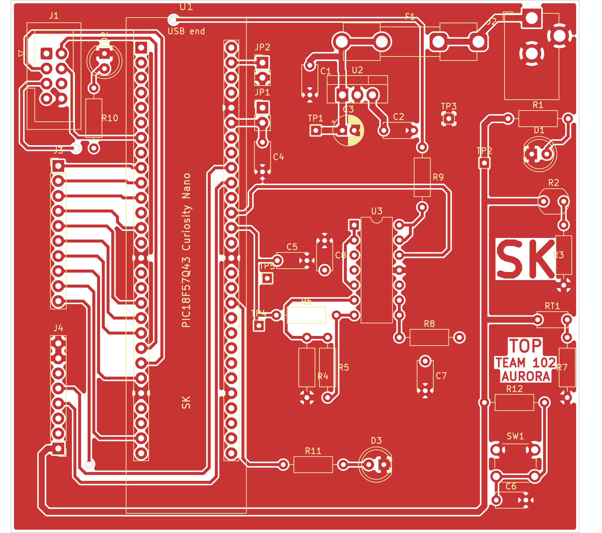
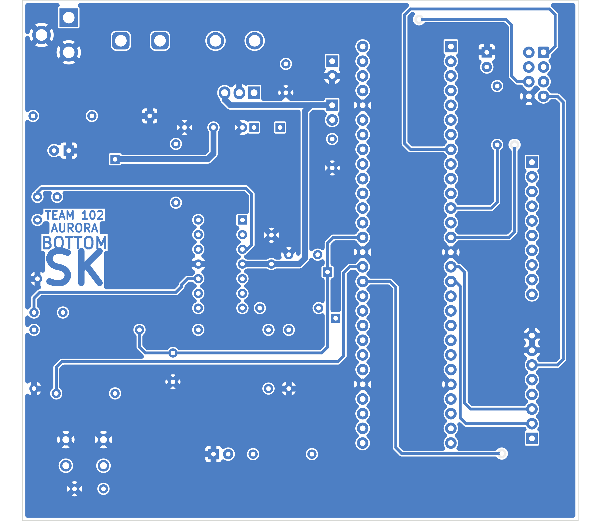

# PCB Design

**Name:** Sam Kholmuminov 
**Team:** Team 102 – Project Aurora 
**Subsystem:** Storage Environment (Board D: Temperature & Light) 
**ECAD tool:** KiCad 10 
**PCB revision:** 1 (from schematic revision 4) 
**Last updated:** November 9, 2026

## What this page is

This page has the printed circuit board layout of my **Storage Environment board**. It is the second step of the subsystem design: the [Schematics](../04-Schematic/schematic.md) page says *what* is connected, this page shows *where* every part sits on the board and how the copper traces connect them. The board is made in-house on the Peralta 109 PCB mill, so the layout follows the Peralta mill rules (two copper layers, no solder mask, no silkscreen, 15 mil signal traces, 40 mil power traces, standard drill sizes).

## Downloads

| File | What it is |
|:--|:--|
| [Storage_Environment_Board_SK_pcb.pdf](files/Storage_Environment_Board_SK_pcb.pdf) | PDF of the layout, page 1 = top copper, page 2 = bottom copper (seen from the bottom, so the text reads normally). Plotted 1:1, so it can be printed at 100 % to check the footprints against the real parts |
| [Storage_Environment_Board_SK_KiCad.zip](files/Storage_Environment_Board_SK_KiCad.zip) | The whole KiCad project: schematic (rev 4), PCB, my symbol library `EGR304_Sam.kicad_sym`, my footprint library `EGR304_SK.pretty`, the library tables and the Gerber folder |
| [SamKholmuminov102.zip](files/SamKholmuminov102.zip) | The manufacturing files only (Gerber layers + Excellon drill files), exactly what was sent to Peralta 109 |
| [Storage_Environment_Board_SK_DFM_report.pdf](files/Storage_Environment_Board_SK_DFM_report.pdf) | The DFM (design for manufacturing) analysis report of the Gerber set from the free JLCPCB online tool, jlcdfm.com |
| [Storage_Environment_Board_SK_pcb_top.png](images/Storage_Environment_Board_SK_pcb_top.png) | Top copper layer as an image (Figure 1) |
| [Storage_Environment_Board_SK_pcb_bottom.png](images/Storage_Environment_Board_SK_pcb_bottom.png) | Bottom copper layer as an image, mirrored so it looks the way the real board looks when you turn it over (Figure 2) |

## The layout

**Figure 1:** Top copper layer (red = copper, white = no copper). The large "SK" and the words TOP / TEAM 102 / AURORA are cut into the copper on the right, as the assignment asks. The yellow outlines are the part bodies (silkscreen), which the mill does not print but which are still in the files.

**Figure 2:** Bottom copper layer, shown from the bottom side. The text (BOTTOM / TEAM 102 / AURORA / SK) reads normally from this side.

## The board in numbers

*Table 1: Facts about the board*

| Item | Value |
|:--|:--|
| Board size | **96 mm × 90 mm** (3.78 in × 3.54 in), inside the 100 mm × 100 mm limit |
| Copper layers | 2 (top and bottom), 0.5 oz/ft² copper, no solder mask, no silkscreen |
| Parts | 40 (all through-hole), 167 pads |
| Signal traces | 20 mil (0.5 mm) wide, 10 mil (0.254 mm) clearance |
| Power traces (+5V, VIN, VTG, ground returns) | 40 mil (1.016 mm) wide |
| Ground | **Earth plane on both sides**, thermal reliefs on every ground pad |
| Vias | 3 (RD6 to J3, HEARTBEAT_D to J1, TEMP_LEVEL to J1), 1.6 mm pad / 0.8 mm hole |
| Drill sizes | only four: 0.8 mm, 1.0 mm, 1.2 mm, 2.0 mm (all on the Peralta bit list) |
| Smallest hole-to-hole distance | 1.2 mm (electrolytic C3), above the 0.8 mm limit |
| Total trace length | about 1.2 m on top, 0.6 m on bottom |

## How the parts are placed

I placed the parts section by section, the same way the schematic is drawn, and kept the ground plane rule from class in mind: with a ground plane on both sides, no ground trace has to be drawn at all; every ground pad just connects to the plane through thermal spokes.

* **Curiosity Nano (U1)** runs top to bottom on the left of the board, USB connector at the top edge so the cable can be plugged in without touching anything else. It plugs into two 1×28 female headers (my `Curiosity_Nano_2x28_P2.54mm_SK` footprint), so the Nano can be pulled off and used elsewhere. Nothing is mounted under it; only traces run there.
* **All connectors on the left edge:** J1 (team ribbon cable, top), J3 (spare GPIO) and J4 (power / analog spare) below it. The ten J3 traces come straight across from the Nano's left row without crossing each other. J4 is turned so its +5 V pin is at the bottom, next to the 40 mil +5 V trace that comes along the bottom edge.
* **Power input in the top right corner:** barrel jack J2 at the top edge (the plug points up, away from the board), then the fuse clips F1, then the L7805 regulator U2 with C1, C3 on its input and C2 on its output, in that order, so the 9 V current takes the shortest path. The regulator tab faces the top edge so a clip-on heat sink would still fit (it is not needed, the dissipation is 0.3 W). TP1 (VIN), TP2 (+5V) and TP3 (Earth) sit next to the regulator.
* **Nano power jumpers JP1, JP2 and C4** are directly beside the Nano's VTG, VOFF and GND pins (top of the right row) so the bypass capacitor is as close to VTG as possible.
* **Op-amp U3** sits in the middle of the right half. Its bypass capacitor C8 is right at pin 4 (VDD). The light channel parts (R4, R5, R6, C5, TP4) are on the left of U3, between U3 and the Nano, because that signal goes to the Nano. The temperature channel parts (R8, C7, TP5) are below and left of U3 for the same reason. The DAC buffer resistor R9 is above U3, where the TEMP_LEVEL trace leaves for the ribbon cable.
* **Sensors on the right edge:** the photocell R2 with its divider resistor R3, and the thermistor RT1 with R7, are on the outer edge so they see the light and the air in the storage area and are not shaded by the Nano or the regulator.
* **Debug parts:** the red warning LED D2 and its resistor R10 are next to the Nano pin that drives them (top left); the yellow debug LED D3 and R11 are at the bottom; the pushbutton SW1, its pull-up R12 and debounce capacitor C6 are in the bottom right corner, where a finger can reach the button.
* **Text in copper:** the big **SK** and the words TOP, TEAM 102, AURORA on the top layer, and BOTTOM, TEAM 102, AURORA, SK (mirrored) on the bottom layer, so each side of the bare board can be told apart.

## How the traces are routed

* Routed by hand, no autorouter. Every corner is a 45° bend, no right angles.
* **Top layer** carries most signal traces and the +5 V bus down the right side; **bottom layer** carries the long vertical runs and the few traces that have to cross something. Because every part is through-hole, a trace can change layer at a pad, so only three vias were needed.
* **+5 V** is a 40 mil trace from the regulator output: one branch to the Nano jumper JP1 and the op-amp (bottom layer), one branch down the right edge past the photocell, thermistor, pull-up and switch, along the bottom edge to J4.
* **VIN** (9 V from the fuse) is a 40 mil trace about 15 mm long: fuse → C3 → C1 → regulator input → TP1.
* **Ground** needs no traces: the Earth plane on both sides reaches every ground pad. Two short 40 mil ground stubs were added anyway (regulator GND pin to C3, Nano GND pin 52 to JP2) where the plane spokes were thin.
* The analog nets (LIGHT_ADC, TEMP_ADC, the sensor divider nodes) are short and stay away from the switching LED lines and the UART.
* The two long ribbon-cable nets that come from the right half of the board (TEMP_LEVEL from the DAC buffer, RIB_A7 from J4) run along the top edge and the left edge of the board, outside everything else.

## Footprints

Every part has a footprint from my own library **`EGR304_SK.pretty`** (initials SK in the library name and in every footprint name). The footprints are based on the standard KiCad ones, with two changes for the mill: every hole uses one of the Peralta drill bits, and every annular ring is at least 0.4 mm (16 mil) so it is not cut away.

*Table 2: Custom footprint library EGR304_SK.pretty*

| Footprint | Used by | Pads / holes |
|:--|:--|:--|
| `Curiosity_Nano_2x28_P2.54mm_SK` | U1 | 2 × 28 pins, 2.54 mm pitch, 15.24 mm (0.6 in) between the rows, 2.0 mm pads, 1.0 mm holes; pin 1 square, pins 1–28 down the left row and 29–56 up the right row with the USB end at the top, like the pinout drawing in the hardware user guide |
| `DIP-14_W7.62mm_SK` | U3 (in a socket) | 1.6 mm pads, 0.8 mm holes |
| `TO-220-3_Vertical_SK` | U2 | 2.0 × 2.2 mm pads, 1.2 mm holes |
| `R_Axial_DIN0207_P10.16mm_SK` | R1, R3–R12 | 10.16 mm pitch, 1.6 mm pads, 0.8 mm holes |
| `R_LDR_5mm_SK` | R2 | NSL-19M51 photocell, 3.4 mm pitch, 1.6 mm pads, 0.8 mm holes |
| `NTC_Disc_P5.00mm_SK` | RT1 | B57164K thermistor, 5.0 mm lead spacing, 1.6 mm pads, 0.8 mm holes |
| `C_Disc_D5.0mm_P5.00mm_SK` | C1, C2, C4–C8 | 5.0 mm pitch, 1.6 mm pads, 0.8 mm holes |
| `CP_Radial_D5.0mm_P2.00mm_SK` | C3 | 2.0 mm pitch electrolytic, square pad = +, 1.6 mm pads, 0.8 mm holes |
| `LED_D5.0mm_SK` | D1, D2, D3 | 5 mm LED, 2.54 mm pitch, 1.8 mm pads, 0.8 mm holes, square pad = cathode (flat side) |
| `Fuseholder_5x20mm_Keystone_3517_SK` | F1 | two clips 23.11 mm apart, 3.0 mm pads, 2.0 mm holes |
| `BarrelJack_PJ-102A_SK` | J2 | pins at 0 / 6.0 / (4.7, 3.0) mm, 3.2 mm pads, 2.0 mm round holes (round holes instead of slots, which the mill cannot cut well) |
| `IDC_Header_2x04_P2.54mm_SK` | J1 | Molex 0702460801 2×4 box header, 2.0 mm pads, 1.0 mm holes, notch on the odd-pin side |
| `PinHeader_1x10_P2.54mm_SK`, `PinHeader_1x08_P2.54mm_SK`, `PinHeader_1x02_P2.54mm_SK` | J3, J4, JP1, JP2 | 2.0 mm pads, 1.0 mm holes |
| `SW_PUSH_6mm_SK` | SW1 | 6 × 6 mm tactile switch, 2.0 mm pads, 1.2 mm holes |
| `TestPoint_THT_1.6mm_SK` | TP1–TP5 | 1.6 mm pad, 0.8 mm hole, fits a header pin or a wire loop |

## Design rules and manufacturing checks

The board setup in KiCad uses the values from the course page *PCB design rules setup in KiCad* and the Peralta mill specifications.

*Table 3: Design rules used (File → Board Setup → Constraints)*

| Rule | Value | Where it comes from |
|:--|:--|:--|
| Minimum clearance | 10 mil (0.254 mm) | course recommendation (mill minimum is 6 mil) |
| Minimum track width | 15 mil (0.381 mm) | Peralta signal trace minimum; my signal traces are 20 mil |
| Power/ground track width | 40 mil (1.016 mm) | Peralta / course checklist |
| Minimum annular ring | 15 mil (0.381 mm) | course page; my smallest ring is 16 mil |
| Minimum via diameter / hole | 19.7 mil / 0.5 mm | Peralta; my vias are 63 mil / 0.8 mm |
| Copper to hole clearance | 10 mil (0.254 mm) | course page |
| Hole to hole clearance | 31.5 mil (0.8 mm) | course page |
| Copper to board edge | 0.5 mm | so the contour router does not nick the copper |
| Solder mask clearance | 5 mil (0.127 mm) | course page (no mask on the Peralta board, but set anyway) |

**Design Rules Check:** Inspect → Design Rules Checker in KiCad reports **0 errors and 0 unconnected items**. The only messages are silkscreen warnings (part outlines from the KiCad library touching their own pads), which do not matter because the silkscreen is not printed on the Peralta board. The screenshot of the DRC window with the board is submitted to Canvas as a separate PDF.

**DFM check (jlcdfm.com):** the Gerber zip was also uploaded to the free JLCPCB online DFM tool, with the order settings from the assignment page (FR-4, 2 layers, 1.6 mm, 1 oz copper). Every copper (routing) check passes with 0 errors: trace width, trace spacing, pad spacing, annular ring, hole spacing, trace and pad to board edge. The tool lists two kinds of warnings, and both come from the copper lettering, not from traces: *sharp trace corner* (the pointed corners inside the letters SK, TOP, BOTTOM, TEAM 102 and AURORA) and *unconnected trace end* (the free ends of the letter strokes – every real trace ends on a pad, a via or another trace). The silkscreen and solder-mask rows report JLCPCB's own factory limits (silkscreen lines at least 0.153 mm wide, no silkscreen on pads), which do not apply to this board because the Peralta mill makes neither layer. The exported report is in the downloads table.

*Table 4: Course PCB checklist*

| Checklist item | Where |
|:--|:--|
| All components have footprints | 40 of 40, all from `EGR304_SK.pretty` (Table 2) |
| Bypass capacitors close to the regulator and the IC power pins | C1/C3 at the regulator input, C2 at its output, C4 at the Nano VTG pin, C8 at the MCP6004 pin 4 |
| Power and ground traces ≥ 40 mil, sized with a trace width calculator | 40 mil; at 75 mA (0.5 A fuse worst case) a 0.5 oz 40 mil trace stays below 10 °C rise |
| Board space for mechanical constraints | the Nano, the jack, the ribbon header and the button are all at the edges; the plug and the cable leave the board at the top and left |
| Top and bottom copper labeled with "top", "bottom" and the group name | TOP / BOTTOM, TEAM 102 AURORA, SK in copper on both sides |
| Few vias, no vias under components | 3 vias, none under a part |
| Through-hole connectors, traces for them on the other side where useful | all parts are through-hole; the Nano and header traces run on both layers around the pads |
| No autorouter, 45° bends, no right angles | hand routed, all corners 45° |
| Test points on 0.1 in spacing | TP1–TP5 plus the spare header pins J3/J4 |
| Programming connector close to the microcontroller | not needed: the Nano is programmed over its own USB connector |

## Manufacturing files

The Gerber set in `SamKholmuminov102.zip` was exported with File → Plot (Gerber, KiCad file extensions, X2 attributes, job file) and File → Plot → Generate Drill Files (Excellon, inches, decimal format, separate PTH and NPTH files):

*Table 6: Files in SamKholmuminov102.zip*

| File | Layer |
|:--|:--|
| Storage_Environment_Board_SK-F_Cu.gbr | top copper |
| Storage_Environment_Board_SK-B_Cu.gbr | bottom copper |
| Storage_Environment_Board_SK-F_Mask.gbr, -B_Mask.gbr | top and bottom solder mask (not used on the Peralta board) |
| Storage_Environment_Board_SK-F_Silkscreen.gbr, -B_Silkscreen.gbr | top and bottom silkscreen (submitted, not used) |
| Storage_Environment_Board_SK-Edge_Cuts.gbr | board outline |
| Storage_Environment_Board_SK-PTH.drl | plated holes (167 pads + 3 vias) |
| Storage_Environment_Board_SK-NPTH.drl | non-plated holes (none on this board) |
| Storage_Environment_Board_SK-job.gbrjob | Gerber job file (layer list) |

The order request on the Peralta site (fultonapps.asu.edu/polylab) is for **one board**, Prof. Zane Reynolds' 10:30 AM EGR 304 section, **no solder mask**, **no rub-out area** (there is no RF antenna on the board), **0.5 oz copper**.

## Sources I used

* [Individual – Subsystem PCB Design assignment](https://embedded-systems-design.bitbucket.io/304/individual-assignments/pcb-design/) and the [PCB design checklist](https://embedded-systems-design.github.io/pcb-design-checklist/)
* [Peralta Studios PCB mill specifications](https://labs.engineering.asu.edu/peraltastudios/pcb-mill-specs) (trace widths, spacing, drill bit list, via sizes)
* Course KiCad pages: [PCB design rules setup in KiCad](https://embedded-systems-design.github.io/pcb-design-rules-setup-in-kicad/), [KiCad PCB design tutorial](https://embedded-systems-design.github.io/kicad-pcb-design-tutorial/), [Adding text to a PCB in KiCad](https://embedded-systems-design.github.io/adding-text-to-pcb-in-kicad/), [Exporting Gerber files from KiCad](https://embedded-systems-design.github.io/exporting-gerber-from-kicad/), [Packaging KiCad files for submission](https://embedded-systems-design.github.io/packaging-kicad-files-for-submission/)
* [PIC18F57Q43 Curiosity Nano Hardware User Guide](https://ww1.microchip.com/downloads/aemDocuments/documents/MCU08/ProductDocuments/UserGuides/PIC18F57Q43-Curiosity-Nano-HW-UserGuide-DS40002186B.pdf) (pinout figure 4-1) and the [Curiosity Nano schematics and assembly drawing](https://ww1.microchip.com/downloads/aemDocuments/documents/MCU08/ProductDocuments/BoardDesignFiles/PIC18F57Q43-Curiosity-Nano-Schematics.pdf) (board 83.82 mm × 20.32 mm, 2.54 mm pitch, 15.24 mm between the pin rows)
* Part drawings on my [BOM](../03-BOM/BOM.md) page: Keystone 3517 clips, Molex 0702460801 header, NSL-19M51 photocell, B57164K thermistor, L7805CV, MCP6004
* [Trace width calculator (Advanced Circuits)](https://www.4pcb.com/trace-width-calculator.html)
* My [Schematics](../04-Schematic/schematic.md) page (revision 4) and my Sensor Design PCB from earlier in the semester (same design rules, same zone settings)
